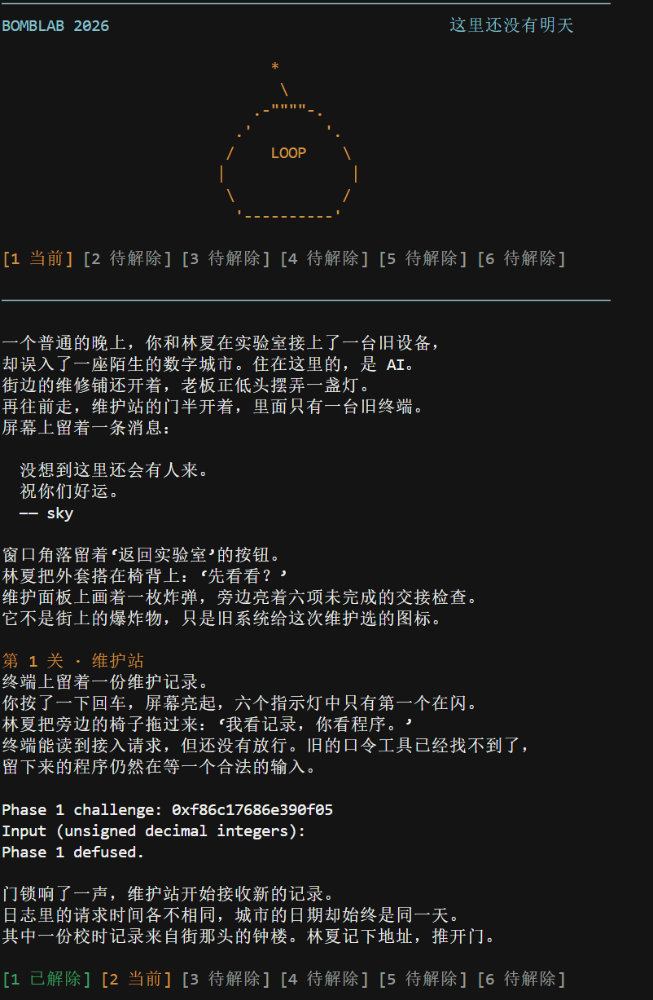
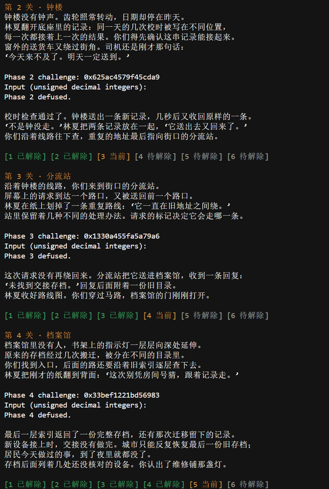
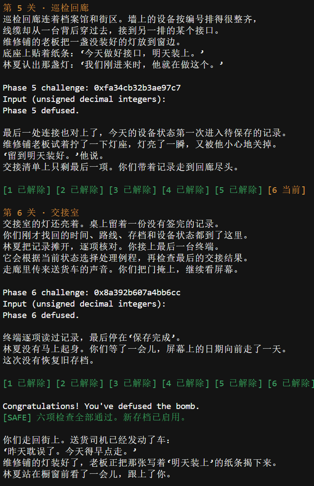
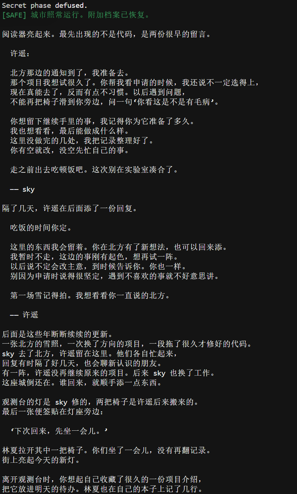
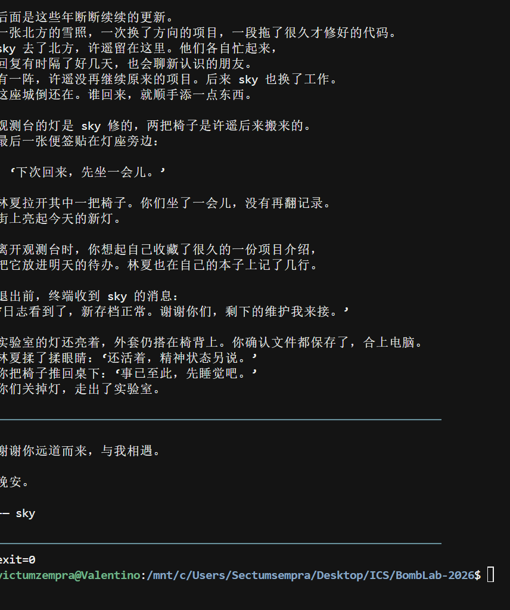
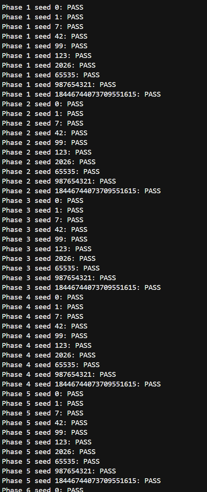
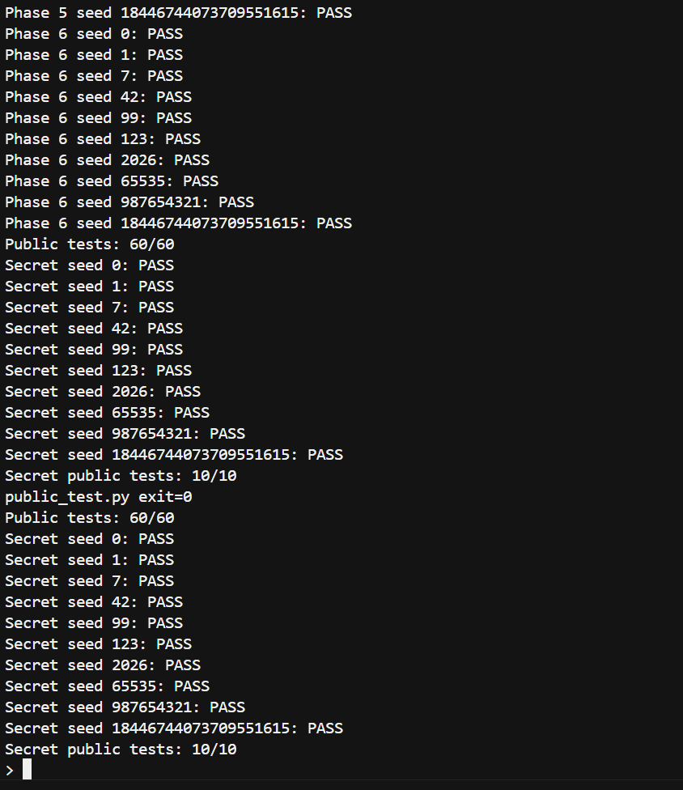

# BombLab 实验报告

吴梓霆　24300120064　

这次用的是自己学号对应的 bomb，package 为 `d1fe0fdff2166f8419f6f063`，环境是 Windows 上的 Ubuntu WSL。下面按各关最容易看错的地方进行整理分析，gpt的使用在最后说明~

用 `c` 表示 64 位 challenge，`u32(x)` 表示只保留低 32 位。对 `c` 和 context 先做 64 位移位，再按公式取位；算出的 32 位数用无符号加减乘，超过范围就保留低 32 位。这样才和 `eax` 等寄存器的运算对应，不能直接全换成 `int`。

## 第一关

第一关看起来有三个小函数，`phase_01` 只读一个整数，最后和 `p1_compute` 的返回值比较，所以我把注意力放在三个 `call` 前的参数上。

```asm
40206e: call p1_step1
40207a: call p1_step0
402083: call p1_step2
402024: lea  eax,[rdi+rsi*8]
402027: xor  eax,0x164f
402036: lea  eax,[rdi+rdi*4+0x6c24]
```

实际顺序是 step1、step0、step2。step1 接到 high 和 middle，结果先保存在 `ecx`；step0 接到 low 和 high；最后 step2 才合并两项。令 `low=u32(c)`、`high=u32(c>>32)`、`middle=u32(c>>16)`，得到：

```text
a = (low + 8*high) ^ 0x164f
b = 5*(high-middle) + 0x6c24
answer = (3*a+b) ^ 0xcad1
```

`lea` 在这里直接完成乘加。另一个要留意的是 middle：它包含原数的第 16 到 47 位，不是一个 16 位字段。seed `20261028` 的输出是 `4192240892`，对应的通过记录我放在了后面。

## 第二关

第二关先检查第一个数，再用循环检查后面五个数。当时有点容易烧脑的是 `shr rax,cl`：移位次数不是一个写在旁边的常量，而是由循环里的指针算出来的。

```asm
402160: shr rax,0x8
402164: and eax,0x1f
402167: lea eax,[rax+rax*2]
402187: shr rax,cl
40218a: and eax,0x3f
40218d: add eax,edi
402192: xor eax,esi
```

进入循环前，`r8d` 是 25 减去起始指针的低 32 位；循环里再加当前指针，所以第一次移 25 位，随后是 29、33、37、 41。`esi` 则从 14 开始，每次加 14。于是：

```text
a[0] = 3*((c>>8)&31)
a[i] = (a[i-1] + ((c>>(21+4*i))&63)) ^ (14*i)
i = 1,2,3,4,5
```

这里先相加再异或，不可以把异或提前。seed `20261028` 得到 `39 56 104 185 227 323`。

<!-- pagebreak -->

## 第三关

第三关最需要核对的是表的顺序。输入有两个数，第一个必须等于 `c&7`，第二个才是分支计算的结果。传入分支的参数是 `x=u32(c>>3)^u32(c>>32)`。

```asm
402321: and edi,0x7
402337: xor esi,eax
40227d: jmp QWORD PTR [rax*8+0x405820]
402288: jmp p3_case_2
```


`jmp` 只告诉我“去表里找地址”，没有说明表的第 0 项就是 case_0。GDB 的 `x/8gx 0x405820` 读出八个地址，再对照各地址的跳转，实际函数顺序是 `1,3,0,4,5,6,2,7`。按输入索引整理后才是：

```text
0: 3*x + 0xdcec          1: (4*x) ^ 0x6cd9
2: 5*x + 0x44c19         3: (x ^ 0xd802) + (x>>2)
4: 5*x + 0x2328          5: 5*x + 0x552f
6: (x ^ 0xbc32) + (x>>2) 7: (4*x) ^ 0x773b
```

例如索引 6 指向 `0x402288`，那里再跳到 `p3_case_2`。seed `20261028` 正好走这项，GDB 记录中 `x=2893802337`，输出 `6 3617215019`。代码中的 switch 按表索引写，函数名的编号只用于核对。

## 第四关

第四关可以看成二分查找，但只找到 target 还没算完。调用参数给出 `target=c&127`、范围 0 到 127，以及 `salt=u32(c>>7)^u32(c>>32)`。

```asm
402358: sub edi,esi
40235a: shr edi,1
40235c: add edi,esi
402370: jb  402390
402377: call p4_walk
40237c: lea eax,[rax+rax*2]
402386: xor eax,0x18
4023a4: xor eax,0x8
```

前面三条指令算出 `mid=low+(high-low)/2`。`jb` 对应 target 小于 mid，去左区间；另一边去右区间。命中时返回 `(mid+0x8b)^salt`，左边返回 `(3*子结果) ^ (mid+salt) ^ 8`，右边最后一项换成 `0x18`。

我觉得这里应把“向下找”和“向上算”分开理解：乘 3 和异或在 call 后面，是返回时才做的。seed `20261028` 的 target 为 3，GDB 中区间逐次缩小，中点为 `63,31,15,7,3`，返回结果是 `1518978567`。target 一定在初始区间内，每次又排除了已经比较过的中点，所以才会终止。

<!-- pagebreak -->

## 第五关

第五关不能按内存地址从小到大处理节点。`[rdx]` 被读回 rdx，说明它保存的是下一个节点的地址；`[rdx+8]` 和 `[rdx+12]` 则各读 4 字节。结合节点地址间隔，可以把每个 16 字节节点认成 next 指针、编号和数值。

```asm
402454: mov rdx,QWORD PTR [rax*8+0x405b60]
402469: mov esi,DWORD PTR [rdx+0x8]
402476: add eax,DWORD PTR [rdx+0xc]
402488: mov rdx,QWORD PTR [rdx]
40248b: lea eax,[rax+rax*2]
402497: xor eax,esi
```

GDB 中用 `x/8gx 0x405b60` 读取头指针，用 `x/48wx 0x405ba0` 读取节点。把地址递增的节点标为 0 到 11，头表是 `6,4,0,8,7,9,1,10`，沿 next 才能得到实际顺序：

```text
6 -> 4 -> 0 -> 8 -> 7 -> 9 -> 1 -> 10 -> 2 -> 3 -> 5 -> 11
```

从 `heads[c&7]` 出发，初值为 `u32(c>>6)^u32(c>>32)^0x33b6`，每个节点做 `acc=(3*acc+value)^id`，输出最后的 acc 和 id。头节点在进入后面的循环前已经处理一次，所以总数是 `((c>>3)&3)+1`，不是少了 1 的版本。

seed `20261028` 从节点 10 开始，只处理它自己。内存中这一项的 id 是 `0x920`，也就是 2336，和输出 `2465137181 2336` 的第二个数一致。代码用数组保存节点数据，但仍然按 next 数组走；最多处理四个节点，八个起点都够用。

## 第六关

第六关与第三关相似，也是先看表，但这里是两次间接 call，第一次返回值还会作为第二次输入。因此只把每个小函数翻译出来还不够。

```asm
4025c6: call QWORD PTR [rax*8+0x405e00]
4025cd: xor  eax,0xde95
4025d4: call QWORD PTR [rbx+0x405e00]
4025df: add  eax,0xd39
```

`x/8ga 0x405e00` 显示实际函数编号为 `0,5,2,2,3,5,4,1`。其中重复地址是原表就有的，不是漏看了函数。按表索引写成 op：

```text
op[0](x) = (x^0x3c38) + 8*x
op[1](x) = op[5](x) = ror32(x,5)
op[2](x) = op[3](x) = rol32(x,3)^0xcc2f
op[4](x) = (x+0xc241)^(x>>3)
op[6](x) = (x^(x>>7))+0x247d
op[7](x) = (2*x+0xc6c5)^(7*x)
```

令 `x=u32(c>>6)^u32(c>>32)`，答案为 `op[(c>>3)&7](op[c&7](x)^0xde95)+0xd39`。第二次 call 的 rbx 已经是 `c&0x38`，表示字节偏移，除以 8 才是表索引。另外 `ror eax,5` 是 32 位循环右移，移出去的低位要从高端补回。seed `20261028` 两次索引为 4 和 1，结果为 `4032126471`。

<!-- pagebreak -->

## Honor

Honor 要通过管道-或文件送入完整七行。我把它分成入口检查和三个数的检查：如果只分析后面的算式，就会漏掉前面的字符串布局。

```asm
402791: sub rax,0x24
402795: cmp rax,0x7f
4027b6: call secret_copy
4027bb: cmp DWORD PTR [rbp-0xb0],0x4e45504f
4027cd: lea rdi,[rbp-0xac]
4027d4: call secret_phase
```

复制从 `rbp-0xd0` 开始，到标志位 `rbp-0xb0` 差 32个字节。`0x4e45504f` 按小端字节序是 `OPEN`，所以布局为 32 个 `A`、`OPEN`、三个数。`strlen` 减去 36 后做无符号比较，说明长度须在 36 到 163 之间。这是局部对象中相邻字段的覆盖，不涉及返回地址。

三个数从偏移 36 开始解析。`secret_phase` 先取 `context&3`，再把 challenge 和 context 各自的高低 32 位异或；`secret_mix` 中的两个 xor 和 add 对应下面 b 的第一部分。记 `k=context`：

```text
x = u32(c)^u32(c>>32)
y = u32(k)^u32(k>>32)
r = k&3
m = x^y
b = ((m^0x2490)+((m>>3)^0x34bd))
    ^ (r*0x2490) ^ u32(k>>16)
d = b ^ (y+r+0x34bd+(x>>3))
```

按 `r b d` 输出。context 由驱动对前六关答案计算，求解函数直接用传入的值，不能填某次运行的常量。seed `20261028` 的 GDB 记录是 `c=0x0cfc7a2e77c65618`、`k=0xc55462df2b938ff7`，三个数为 `3 3395433487 877482849`。在 `0x4027bb` 停下，偏移 32 的四个字节确实是 `OPEN`，继续后出现 `Secret phase defused.`。

## 验证和一点感受

10 月 30 日在独立副本中重新编译并复核：公开测试 60/60、Honor 10/10；额外逐关各 947 个 challenge，共 5,682 次通过；256 个完整七关流程通过，覆盖四个 Honor 路由；输出空间 0 到 256 的 5,397 次检查通过。补测直接把解法输出交给原始 bomb 判断，没有拿同一套公式当裁判。另留有四个是我们额外选的测试数字 seed 的完整记录，包含下面的 `20261028`。

我觉得实验偏难，尤其是递归返回和 Honor 的偏移，把几条指令分别读懂以后，还是不容易连起来。希望结构体布局、跳转表和间接调用能再多给一些小例子，帮助从汇编代码反推到C，而不只是知道每条指令的意思。

<!-- pagebreak -->

## 自己选的 seed 的运行记录

以下 seed 不在 `tests/public.json` 中。前六关及 Honor 使用同一个 seed，命令是：

```sh
{ ./defuser --seed 20261028;
  ./defuser --secret --seed 20261028; } | ./bomb --seed 20261028
```

这次运行的前六行答案分别是：

```text
4192240892
39 56 104 185 227 323
6 3617215019
1518978567
2465137181 2336
4032126471
```

下面五张是我补充的本机 WSL 终端截图，按运行顺序保留。图中的六个 challenge 与 seed `20261028` 的验证记录一致，分别展示了六关通过、Honor 通过和最后的 `exit=0`。剧情较长，因此分段截图，图片内容未改动。

<!-- pagebreak -->



<!-- pagebreak -->



<!-- pagebreak -->



<!-- pagebreak -->



<!-- pagebreak -->



<!-- pagebreak -->

## 公开测试

运行 `python3 public_test.py`，六关公开测试为 60/60，Honor 为 10/10，退出状态为 0。下面保留两张终端截图，后一张同时包含测试末尾和再次显示的日志摘要，重复的汇总不另计一次测试。



<!-- pagebreak -->



<!-- pagebreak -->

## 参考资料与辅助说明

实验文档：[2026 BombLab](https://ics-26fall-fdu.github.io/labs/lab2-bomb-lab/)。接口、challenge 生成方式和测试方法参考了[本届模板仓库](https://github.com/ICS-26Fall-FDU/BombLab)。

工具方面，GPT参与了部分思路的提供 文字整理；objdump 和 GDB 用于核对个人 bomb。

公开测试和本地补测都通过啦
⾄此，BombLab完结撒花~